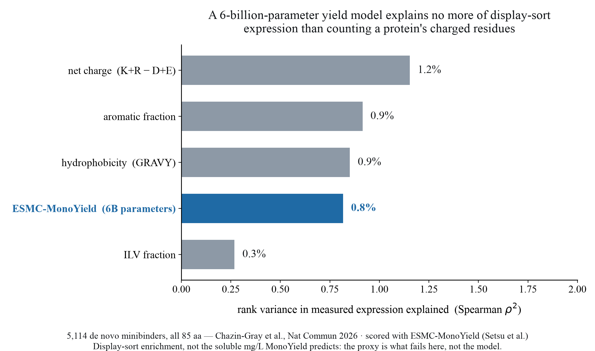

# Display-sort enrichment doesn't carry enough signal to validate a yield predictor



5,114 de novo minibinders, every one 85 aa, each with a per-design expression readout —
including the ones that failed outright. Scored with
[ESMC-MonoYield](https://github.com/tsubo-lab/monoyield-predictor) using the authors' own
weights.

It explains **0.8%** of the rank variance. Net charge explains **1.2%**. Nothing clears ~1%,
so the limit is the label, not the model.

## The data

The expression readout was already public but not presented as one. Supplementary Data 5 of
[Chazin-Gray et al., *Nat Commun* 2026](https://doi.org/10.1038/s41467-026-78123-6) is an NGS
pool table whose `sort` column includes an `expression` sort alongside `naive`, so every design
in the library has an expression measurement.

`data/fimh_display_expression.csv` — 5,114 rows. `log2_expressed` = log2(expression / naive),
spanning −7.2 to +4.8. `expression_flag` is `ok` (5,021), `zero_expression` (52, real naive
reads and zero expression reads) or `no_naive_reads` (41). Fixed length means length cannot
confound a sequence model.

`data/fimh_monoyield_predictions.csv` — ESMC-MonoYield output, mean of the five folds.

## Caveats

This is **display-sort enrichment, not the soluble mg/L** MonoYield predicts — a proxy, usable
rank-only within this library. MonoYield's own binder validation is a different and cleaner
measurement: 11 high-scoring plus 10 randomly sampled BindCraft designs by HPLC-SEC
([Setsu et al.](https://doi.org/10.64898/2026.11.02.763507)). Nothing here contradicts it.

The paper screened FimH by cDNA display and Abp by yeast display; the table does not say which
platform the 3,857 `Adhesin` rows used.

## Reproducing

```
python scripts/make_fimh_display_expression.py   # re-downloads the source table
python scripts/plot_fimh_label_signal.py         # rebuilds the figure
```

Data from the papers above, reused under their open-access terms. Code here: MIT.
